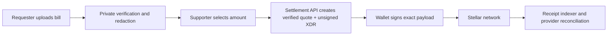

<div align="center">

# SETTLE

### Verify a bill. Fund it directly. Keep the receipt.

An AI-assisted, cross-platform bill-support experience built with Expo and designed for Stellar settlement.

<p>
  <a href="https://github.com/anasabubakar/settle/actions"></a>
  <a href="https://github.com/anasabubakar/settle/releases"></a>
  <a href="LICENSE"></a>
  <a href="CONTRIBUTING.md"></a>
</p>

<p>
  
  
  
  
  
</p>

<a href="#quick-start">Quick start</a> · <a href="#what-it-does">What it does</a> · <a href="docs/stellar-readiness.md">Stellar readiness</a> · <a href="#roadmap">Roadmap</a> · <a href="CONTRIBUTING.md">Contributing</a>

</div>

---

## What is Settle?

Settle is an evidence-led way to support an essential bill. A requester uploads a bill, Settle extracts and redacts relevant fields, then a supporter can swipe to fund part or all of the verified request. The intended route is provider-direct settlement: help reaches a biller, not a public personal wallet.

Support is never payment for access, labor, publicity, a relationship, or any other personal demand. Optional Kind Gestures are safe acknowledgements that a requester can decline freely.

## What it does

| Requester | Supporter | Settlement foundation |
|---|---|---|
| Upload photos or PDFs of a bill | Swipe through verified requests | Stellar network configuration defaults to testnet |
| AI review, field extraction, and privacy redaction preview | Fund a custom, partial, or complete amount | Server-verified quote and authorization data types |
| Publish a respectful request | Add an optional, non-transactional Kind Gesture | Mainnet capability is explicitly gated |

## Product status

| Surface | Status | Notes |
|---|---|---|
| Web app | ✅ Interactive | Expo web export available |
| Android / iOS | ✅ Expo source | Use Expo Go for the current UI prototype |
| Bill uploads | ✅ Local picker flow | No real documents are sent to a server yet |
| AI review | 🟡 Product simulation | Needs private, audited backend processing |
| Stellar settlement | 🟡 Testnet foundation | No wallet adapter, quote service, or live transaction yet |
| Mainnet funds | 🔴 Not enabled | Requires the [readiness guide](docs/stellar-readiness.md) |

## Quick start

```bash
git clone https://github.com/anasabubakar/settle.git
cd settle
npm install
npm run web
```

For mobile development, run `npm start`, then open the Expo Go QR code. Use `npm run android` or `npm run ios` when you have the relevant local tooling.

### Environment

```bash
cp .env.example .env.local
```

The app defaults to Stellar testnet. Never put signing keys, provider credentials, API secrets, or personal documents in an `EXPO_PUBLIC_*` environment variable.

## How payment will work



The client never derives USDC from a fiat bill amount, invents a provider destination, chooses an issuer, or holds a signing key. Read [Stellar readiness](docs/stellar-readiness.md) before proposing a mainnet integration.

## Project layout

| Path | Purpose |
|---|---|
| `src/app/` | Expo Router screens |
| `src/components/` | Shared UI, animation, contribution, and gesture flows |
| `src/services/stellar.ts` | Client-safe network and server-quote boundary |
| `src/data/` | Sample data only |
| `assets/animations/` | Local Lottie assets |
| `docs/` | Architecture and operating guidance |

## Verify locally

```bash
npx tsc --noEmit
npm run lint
npx expo export --platform web
npx expo-doctor
```

## Roadmap

- [x] Responsive web, iOS, and Android Expo experience
- [x] Bill photo/PDF selection and AI-review UI
- [x] Direct-support guardrails and optional Kind Gestures
- [x] Stellar testnet configuration and server-quote boundary
- [ ] Private evidence storage, redaction, and human review workflow
- [ ] Provider verification and a settlement API
- [ ] Testnet wallet signing, confirmation observer, and receipt indexer
- [ ] Security/compliance review, closed pilot, and mainnet decision

## Contributing

Contributions are welcome. Read [CONTRIBUTING.md](CONTRIBUTING.md), follow the [Code of Conduct](CODE_OF_CONDUCT.md), and use the issue templates.

## Security and safety

Do not report vulnerabilities in a public issue. See [SECURITY.md](SECURITY.md). This repository is not a money-transmission service and does not currently move real funds.

## License

MIT © 2026 Anas Abubakar. See [LICENSE](LICENSE).
